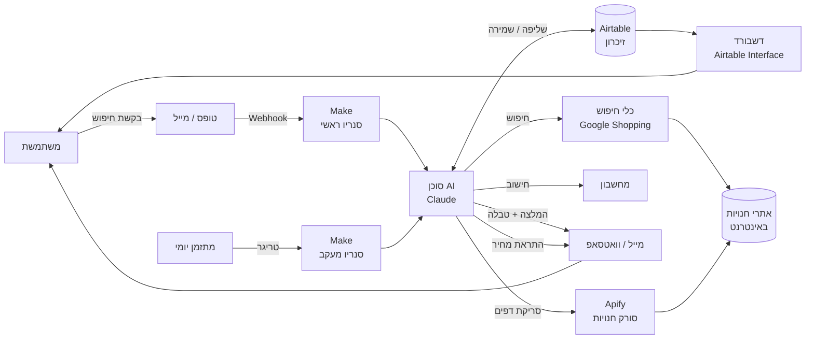
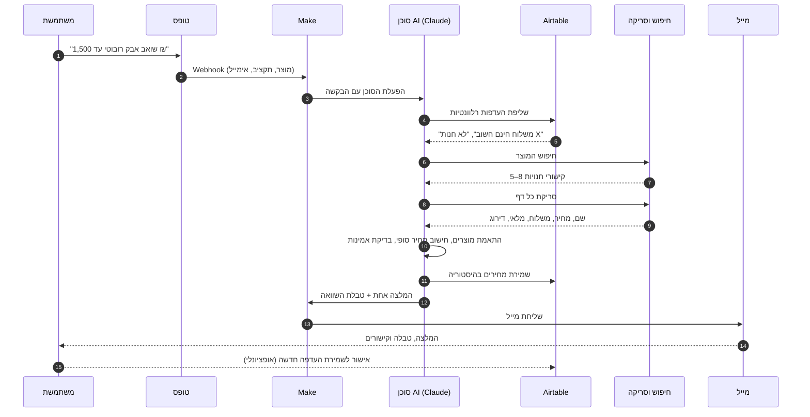
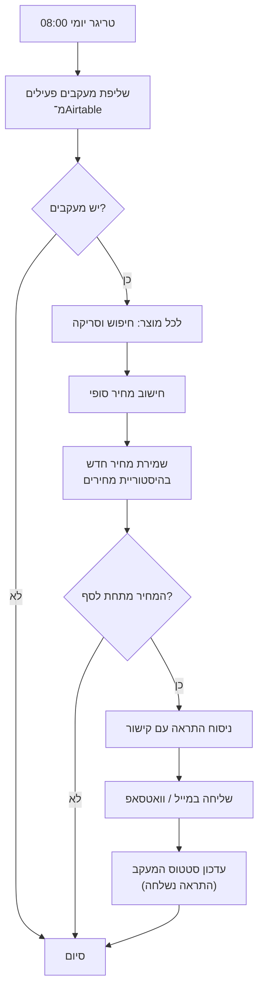
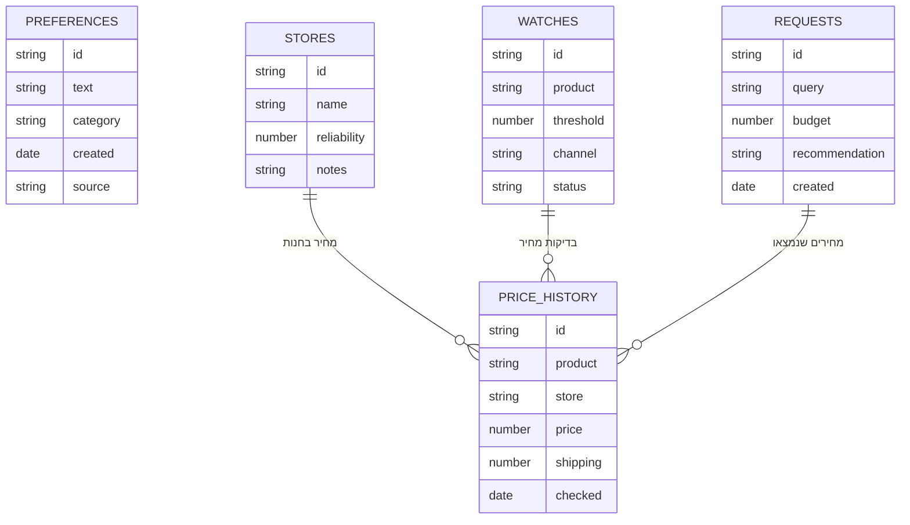

# ארכיטקטורה: סוכן AI להשוואת מחירים

**ריפו:** https://github.com/spbila2/price-comparison-agent · **אפיון מלא:** [SPEC.md](SPEC.md)

מסמך זה מתאר איך הסוכן רץ בפועל: מה מפעיל אותו (טריגר), איך המידע זורם בין הרכיבים, ומה עושים עם הפלט.

## 1. פלטפורמה ורכיבים

**פלטפורמת הרצה: Make.** סנריו אחד מנהל את הזרימה, ובתוכו מודול סוכן AI (Claude) שמחליט אילו כלים להפעיל.

| רכיב | תפקיד | טכנולוגיה |
|---|---|---|
| ממשק משתמשת | קבלת בקשה וקבלת תשובה | טופס (Airtable Form / Tally), מייל, בהמשך וואטסאפ |
| מתזמן | הפעלת בדיקות מחיר חוזרות | Make Scheduler (בכל יום ב־08:00) |
| תזמור | ניהול הזרימה, ניתוב, טיפול בשגיאות | Make (סנריו) |
| סוכן AI | הבנת הבקשה, בחירת כלים, התאמה, דירוג, ניסוח המלצה | Claude (מודול סוכן ב־Make) |
| כלי חיפוש | איתור חנויות ומוצרים | SerpAPI / Google Shopping |
| כלי סריקה | טעינת דפי חנות | Apify (Actor לסריקת דפים) |
| כלי חישוב | מחיר סופי והפרשים | מודול חישוב ב־Make |
| בסיס נתונים (זיכרון) | העדפות, היסטוריית מחירים, מעקבים, חנויות | Airtable |
| התראות ותשובות | שליחת המלצה והתראות מחיר | Gmail (בהמשך וואטסאפ) |
| דשבורד | תצוגה של מחירים, מעקבים וחיסכון | Airtable Interface (או עמוד HTML) |

## 2. תרשים מערכת כללי

## 3. טריגרים: מה מפעיל את הסוכן

| טריגר | מתי | מה קורה | סנריו |
|---|---|---|---|
| **בקשה חדשה** | המשתמשת שולחת טופס או מייל עם מוצר ותקציב | הסוכן מריץ את כל הזרימה ושולח המלצה | סנריו ראשי |
| **בדיקת מעקב יומית** | כל יום ב־08:00 | הסוכן בודק מחיר של כל מוצר במעקב, ושולח התראה אם ירד מתחת לסף | סנריו מעקב |
| **שינוי בטבלת מעקבים** | המשתמשת מוסיפה מוצר למעקב ב־Airtable | נשמרת רשומה, ונקבעת בדיקה ראשונה מיידית | סנריו מעקב |
| **שגיאה בסנריו** | כלי נכשל פעמיים | נשלחת למנהלת המערכת הודעת שגיאה, והמשתמשת מקבלת תשובה חלקית | טיפול בשגיאות |

## 4. זרימת מידע: בקשת חיפוש

## 5. זרימת מידע: מעקב מחירים והתראות

## 6. בסיס הנתונים (Airtable)

| טבלה | נכתבת על ידי | נקראת על ידי |
|---|---|---|
| העדפות | הסוכן, אחרי אישור המשתמשת | הסוכן בתחילת כל בקשה |
| היסטוריית מחירים | הסוכן בכל חיפוש ובכל בדיקת מעקב | הסוכן (השוואה לעבר), הדשבורד |
| מעקבים | המשתמשת (טופס או טבלה) והסוכן (סטטוס) | סנריו מעקב |
| חנויות | הסוכן (ציון אמינות שנצבר) | הסוכן ושלב הדירוג |
| בקשות | הסוכן | הדשבורד |

## 7. מה עושים עם הפלט

| פלט | יעד | שימוש |
|---|---|---|
| המלצה + טבלת השוואה | מייל למשתמשת | קבלת החלטה וקנייה בעצמה |
| התראת ירידת מחיר | מייל / וואטסאפ | קנייה ברגע הנכון |
| מחירים שנמצאו | Airtable (היסטוריית מחירים) | מעקב מגמות וזיהוי "מחיר טוב באמת" |
| רשומת בקשה והמלצה | Airtable (בקשות) | תיעוד ותחקור איכות ההמלצות |
| שגיאות וכשלי כלים | הודעה למנהלת המערכת | תיקון סורקים שנשברו |
| נתוני הדשבורד | Airtable Interface | תצוגה מרוכזת |

## 8. דשבורד

הדשבורד הוא תצוגה בלבד על טבלאות Airtable, ללא לוגיקה משלו.

| רכיב בדשבורד | מקור הנתונים | מה מראה |
|---|---|---|
| מעקבים פעילים | מעקבים | מוצר, סף, מחיר נוכחי, סטטוס |
| גרף מחיר לאורך זמן | היסטוריית מחירים | מגמת מחיר לכל מוצר, לפי חנות |
| בקשות אחרונות | בקשות | מה חיפשה ומה הומלץ |
| חיסכון מצטבר | בקשות + היסטוריית מחירים | הפרש בין המחיר שנמצא לחציון השוק |
| בריאות הסורקים | יומן שגיאות | אילו חנויות נכשלו לאחרונה |

## 9. שליטה, אבטחה וגבולות

- **אין פעולות בלתי הפיכות.** הסוכן לא קונה ולא מזין פרטי תשלום, והפלט הוא המלצה בלבד.
- **מפתחות וחיבורים** (Airtable, Apify, SerpAPI, Gmail) נשמרים בחיבורים של Make ולא בקוד או בריפו.
- **נתונים בריפו:** הריפו ציבורי ומכיל תכנון בלבד. אין בו מפתחות, קבצי נתונים או כתובות מייל אישיות.
- **גישה לדשבורד ולטבלאות:** רק למשתמשת ולמי שהוזמן ל־base.
- **תוכן מאתרים הוא מידע בלבד.** טקסט בדף חנות לא משנה את התנהגות הסוכן.
- **הגבלת עלות:** עד 5 חנויות בבקשה, מטמון של 24 שעות, ותקרת בקשות יומית ב־Make.
- **כיבוד אתרים:** robots.txt, הגבלת קצב, ללא עקיפת חסימות.

## 10. שלבי הקמה על Make

1. יצירת base ב־Airtable עם חמש הטבלאות שבסעיף 6.
2. סנריו ראשי: Webhook ← סוכן AI עם כלי חיפוש, סריקה וחישוב ← כתיבה ל־Airtable ← שליחת מייל.
3. בדיקה על קטגוריה אחת (אלקטרוניקה) ושלוש חנויות.
4. סנריו מעקב עם טריגר יומי והתראות.
5. דשבורד ב־Airtable Interface.
6. בדיקת מדדי ההצלחה מ־[SPEC.md](SPEC.md) והרחבה לקטגוריות נוספות.

